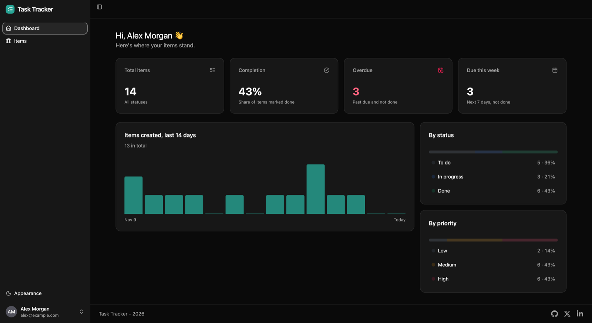
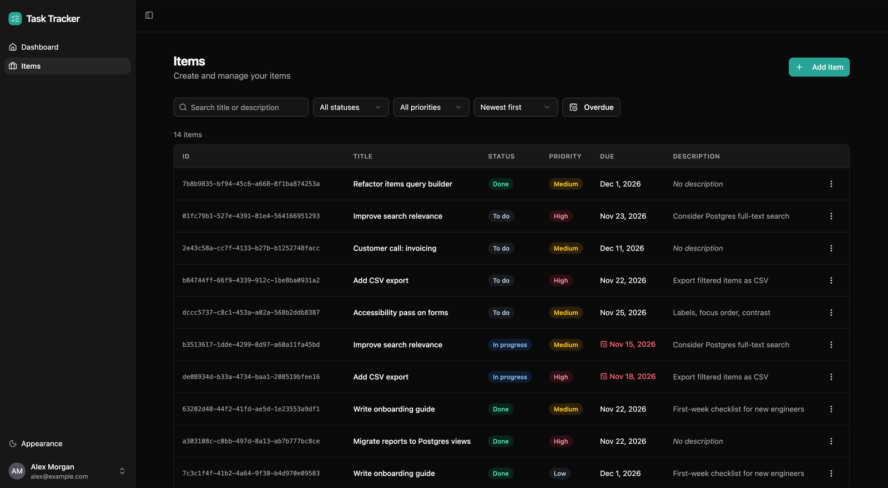
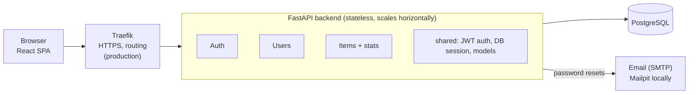
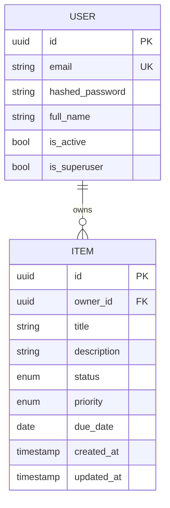

# Task Tracker

A multi-user task tracker. People log in, manage their tasks with status, priority and due dates, find them fast with search and filters, and see a live dashboard of where things stand. Admins see everything and manage user accounts.

**Stack:** React + TypeScript · FastAPI (Python 3.14) · PostgreSQL 18 · Docker Compose

**Design doc:** [docs/design.md](docs/design.md) covers requirements, entities, API, data model and design trade-offs in detail.





## Features

**For every user**

- **Accounts:** sign up, log in, edit profile, change password, reset a forgotten password by email.
- **Tasks:** create, edit and delete tasks with title, description, status (To do / In progress / Done), priority (Low / Medium / High) and an optional due date.
- **Find things fast:** text search, filters by status, priority and overdue, and sorting by date, due date, priority or title. Filters live in the URL, so a filtered view can be bookmarked or shared.
- **Dashboard:** total tasks, completion rate, overdue and due-this-week counts, a 14-day activity chart, and breakdowns by status and priority. Every card links to the matching filtered list.
- **Light and dark mode.**

**For admins**

- See every user's tasks and stats.
- Create, edit, deactivate and delete users.

**Under the hood**

- Ownership enforced on the server: users can only ever read or change their own tasks.
- All dashboard numbers are aggregated in SQL by one endpoint (`GET /api/v1/items/stats`).
- The frontend API client is generated from the backend's OpenAPI schema, so types can't drift.
- Versioned schema changes with Alembic; 69 automated backend tests.

## How it works



- **Frontend:** a React single-page app. Pages are files in `frontend/src/routes/` (TanStack Router), server data is fetched and cached with TanStack Query, and the UI is built with Tailwind and Radix components.
- **Backend:** one FastAPI service organised into modules (auth, users, items). Every request gets a database session and the current user, decoded from a JWT, injected by FastAPI's dependency system. Request bodies are validated automatically; bad input never reaches the business logic.
- **Data:** PostgreSQL. One SQLModel class defines both a table and its API shape. Schema changes go through Alembic migrations.
- **Auth:** OAuth2 password flow issuing signed JWTs; passwords hashed with Argon2.
- **Runtime:** Docker Compose runs Postgres, the backend (which also serves the built frontend), Traefik, Adminer and Mailpit.

**One request, end to end (creating a task):** the form calls the generated client → `POST /api/v1/items/` with the JWT → FastAPI verifies the token and opens a DB session → validates the body → saves the task with the caller as owner → returns the public fields → the frontend refreshes the list and the dashboard.

## Data model



## Run it locally

Requirements: Docker Desktop.

```bash
# 1. Edit .env and replace every "changethis" (SECRET_KEY, FIRST_SUPERUSER_PASSWORD, POSTGRES_PASSWORD)

# 2. Start the services
docker compose up -d db backend mailpit proxy adminer

# 3. Run migrations and create the first admin user
docker compose exec backend bash scripts/prestart.sh

# 4. Load demo data (2 users, 32 tasks)
docker compose exec backend python app/seed_demo.py
```

| What | URL |
| --- | --- |
| App | http://localhost:8000 |
| API docs (Swagger) | http://localhost:8000/docs |
| Database UI (Adminer) | http://localhost:8080 |
| Captured emails (Mailpit) | http://localhost:8025 |

**Demo logins:** the admin from `FIRST_SUPERUSER` / `FIRST_SUPERUSER_PASSWORD` in `.env`, and `alex@example.com` / `demo-password-123` (a regular user who sees only their own tasks).

**Tests:** `docker compose exec backend bash scripts/tests-start.sh`. The tests use the same database and clear it at the end, so run steps 3 and 4 again afterwards.

For live reload while coding, local frontend development and deployment, see [development.md](development.md) and [deployment.md](deployment.md).

## Project structure

```
backend/app/
  api/routes/      endpoints: login, users, items (+ stats), utils
  api/deps.py      injected dependencies: DB session, current user
  models.py        SQLModel tables and API schemas
  core/            config, database engine, security (JWT, hashing)
  alembic/         database migrations
  seed_demo.py     demo data
backend/tests/     pytest suite
frontend/src/
  routes/          pages (file-based routing)
  components/      UI components (Items, Admin, Sidebar, ...)
  client/          API client generated from OpenAPI
docs/design.md     product and system design
```

## What I built on top of the template

This project starts from the official [Full Stack FastAPI Template](https://github.com/fastapi/full-stack-fastapi-template), which provides authentication, user management, a basic items CRUD and the Docker setup. I extended it using Claude Code as a pair programmer: I set the design, reviewed every diff and fixed generated code where it was wrong.

| Area | Change |
| --- | --- |
| Data model | `status` and `priority` (Postgres enums), `due_date`, `updated_at`, composite index on `(owner_id, created_at)` |
| Migration | Alembic's autogenerated migration fixed by hand: create the enum types, server defaults for existing rows, backfill `updated_at`, drop the enums on downgrade |
| Tasks API | Search, filters, allow-listed sorting and a capped page size, built on one query builder with a single ownership helper |
| Stats API | `GET /items/stats`: totals, completion rate, overdue, due this week, 14-day activity and breakdowns, aggregated in SQL |
| Frontend | The dashboard, the filterable task list with URL state and debounced search, and the new fields in forms and the table |
| Auth fix | A valid token for a deleted user returned 404 and the UI hung on loading; it now returns 401 so the app logs the user out |
| Tests | 11 new backend tests: filters, sorting, permission isolation, stats and the 401 fix |
| Branding | Renamed to Task Tracker with a text and icon logo |

## License

MIT, inherited from the Full Stack FastAPI Template. See [LICENSE](LICENSE).
