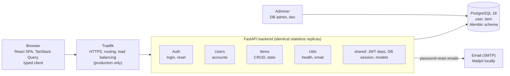
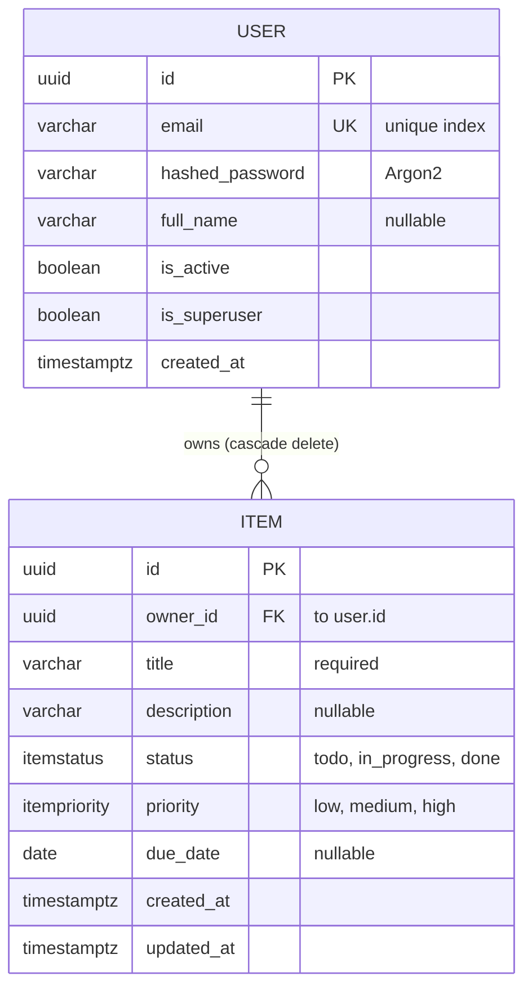

# Task Tracker: Product and System Design

Live, editable version: https://claude.ai/artifact/QrM6eYh76u6v266XWmqdib

## Overview

A multi-user task tracker: people log in, manage their work items with status, priority and due dates, and see a live dashboard of where things stand. Admins see everything and manage user accounts.

| | |
| --- | --- |
| Users | Members (own items only), admins (all items + user management) |
| Frontend | React + TypeScript (Vite), TanStack Router and Query, Tailwind + Radix UI |
| Backend | FastAPI (Python 3.14), SQLModel, JWT auth, Argon2 password hashing |
| Data | PostgreSQL 18, Alembic migrations |
| Runtime | Docker Compose: backend (also serves the built frontend), Postgres, Traefik, Adminer, Mailpit |
| Origin | Official Full Stack FastAPI Template, extended with the task model, search and filters, dashboard + stats API, tests and an auth fix |

Built with Claude Code as a pair: I set the design and reviewed every diff, including fixing generated code that was wrong.

## Functional requirements

Core (in scope):

1. Users can sign up, log in, update their profile and password, and reset a forgotten password by email.
2. Users can create, view, edit and delete items with title, description, status, priority and due date.
3. Users can search items by text, filter by status, priority and overdue, and sort by date, due date, priority or title.
4. Users can see a dashboard: totals, completion rate, overdue and due-this-week counts, 14-day activity, breakdowns by status and priority.
5. Admins can see all items and stats, and create, edit, deactivate and delete users.

Out of scope (for now): shared or team items, comments, attachments, notifications, real-time updates, mobile apps.

## Non-functional requirements

The system favours correctness and security over raw scale: a task tracker must never show one user another user's data.

| Quality | Target | How it is met |
| --- | --- | --- |
| Security | Users only ever read or change their own items | Ownership enforced server-side in one helper (`visible_items`); JWT on every request; Argon2 hashing |
| Consistency | Strong: a saved item appears immediately | Single Postgres primary, transactional writes; frontend refetches after each change |
| Latency | List and stats p95 under 200 ms at demo scale | Composite index on (owner_id, created_at); aggregation in SQL, not Python |
| Input safety | Invalid input never reaches business logic | Pydantic validation (422), enum types, sort allow-list, bound query parameters |
| Availability | Single-node is acceptable for now | Stateless backend, so it scales horizontally behind Traefik when needed |
| Maintainability | Frontend and backend types never drift | OpenAPI schema generates the TypeScript client; migrations version the schema; 69 automated tests |

Scale assumption: thousands of users, tens of thousands of items. Larger scale changes the design (see Deep dives).

## Core entities

Two entities, one relationship: a **User** owns many **Items**; deleting a user deletes their items (cascade).

| Entity | Represents | Key fields |
| --- | --- | --- |
| User | An account, member or admin | id, email (unique), hashed_password, full_name, is_active, is_superuser, created_at |
| Item | One task | id, owner_id, title, description, status, priority, due_date, created_at, updated_at |
| ItemStatus (enum) | Workflow state | todo, in_progress, done |
| ItemPriority (enum) | Urgency | low, medium, high |

Each entity has separate API shapes: `ItemCreate` (input), `ItemUpdate` (all optional, partial update), `ItemPublic` (output). Clients can never set `id` or `owner_id`, and `hashed_password` is never returned.

## API

REST over JSON under `/api/v1`. Every endpoint except login, signup, password recovery and health check needs `Authorization: Bearer <JWT>`. Interactive docs: `/docs`.

**Items (core)**

| Method + path | Input | Returns |
| --- | --- | --- |
| `GET /items/` | query: `q`, `status`, `priority`, `overdue`, `sort` (allow-listed, e.g. `-priority`), `skip`, `limit` (1–100) | `{ data: ItemPublic[], count }` |
| `GET /items/stats` | none | `ItemsStats`: total, overdue, due_this_week, completion_rate, by_status, by_priority, created_per_day[14] |
| `GET /items/{id}` | path id | `ItemPublic` (403 if not yours) |
| `POST /items/` | `ItemCreate`: title, description?, status?, priority?, due_date? | `ItemPublic` |
| `PUT /items/{id}` | `ItemUpdate`: any subset of fields | `ItemPublic` (sets `updated_at`) |
| `DELETE /items/{id}` | path id | `{ message }` |

**Auth and users**

| Method + path | Purpose |
| --- | --- |
| `POST /login/access-token` | Form `username`, `password` → `{ access_token, token_type }` (JWT, 8-day expiry) |
| `POST /password-recovery/{email}` | Email a reset link (48-hour token) |
| `POST /reset-password/` | `{ token, new_password }` |
| `POST /users/signup` | Self-registration |
| `GET` / `PATCH` / `DELETE /users/me`, `PATCH /users/me/password` | Own profile and password |
| `GET` / `POST /users/`, `GET` / `PATCH` / `DELETE /users/{id}` | Admin only: user management |

Errors: 401 not authenticated (bad or stale token), 403 not allowed, 404 not found, 422 invalid input.

## High-level design

A single-page React app talks JSON to one modular, stateless FastAPI service, which is the only thing that touches Postgres.

Locally the browser calls the backend directly on port 8000; in production Traefik terminates HTTPS and routes by domain. Because the backend keeps no session state (auth is in the JWT), more backend replicas can be added behind Traefik without changes. Today it runs as one container (4 worker processes in production mode).

**How a request flows (create an item)**

1. The form calls the generated client's `ItemsService.createItem`, sending the JWT in the `Authorization` header.
2. FastAPI matches `POST /api/v1/items/` and resolves dependencies: a DB session per request, and `CurrentUser` from the verified token.
3. The body is validated against `ItemCreate`; invalid input returns 422 before any code runs.
4. The route saves an `Item` owned by the caller (the client can't choose the owner) and returns `ItemPublic`.
5. The frontend invalidates the `items` cache key, so the list and the dashboard refetch.

## Database choice and data model

PostgreSQL, because the data is relational (users own items), needs strong consistency, and the dashboard is aggregation-heavy, which SQL does well.

| Option | Verdict | Why |
| --- | --- | --- |
| PostgreSQL | Chosen | ACID transactions, foreign keys with cascade, native enums, GROUP BY / date functions for stats, ILIKE today and full-text search later |
| MongoDB | Not chosen | Flexible documents aren't needed; ownership and aggregation are easier with joins and SQL |
| DynamoDB | Not chosen | Great at key lookups at huge scale, poor fit for ad-hoc filters, text search and dashboard aggregates |
| Redis | Later, as a cache only | Speeds up repeated reads; not the source of truth (see Proposed next features) |

**Schema**

| Table.column | Type | Constraints |
| --- | --- | --- |
| user.id | UUID | primary key |
| user.email | varchar(255) | unique, indexed |
| user.hashed_password | varchar | Argon2 hash |
| user.full_name | varchar(255) | nullable |
| user.is_active / is_superuser | boolean | defaults true / false |
| user.created_at | timestamptz | |
| item.id | UUID | primary key |
| item.owner_id | UUID | FK → user.id, ON DELETE CASCADE |
| item.title | varchar(255) | not null, 1–255 chars |
| item.description | varchar(255) | nullable |
| item.status | enum itemstatus | not null, default 'todo' |
| item.priority | enum itempriority | not null, default 'medium' |
| item.due_date | date | nullable |
| item.created_at / updated_at | timestamptz | updated_at set on every edit |

**Indexes:** unique index on `user.email` (login lookup); composite index `ix_item_owner_id_created_at` on (owner_id, created_at), because every list query filters by owner and sorts by newest first.

**Why UUIDs:** IDs can't be guessed or enumerated, and can be generated without a database round trip.

## Deep dives

**Why a modular monolith, not microservices.** The backend is one FastAPI service split into modules (auth, users, items, utils) that share the JWT dependencies, DB session and models. For two tables, one team and data that must stay consistent (a user and their items change together), one deployable is simpler and faster: no network hops between modules, no distributed transactions, one thing to deploy and debug. It still scales: the service is stateless, so identical replicas run behind Traefik (production already runs 4 worker processes per container). I would split a module out when its load, failure modes or ownership differ. The planned AI summary is the first candidate: it is slow, calls an external API and costs money per request, so it belongs in its own service or background worker.

**Authentication.** OAuth2 password flow: the login form posts credentials, the server verifies the Argon2 hash and returns a JWT signed with HS256 and `SECRET_KEY`, holding the user id (`sub`) and expiry. Each request's `CurrentUser` dependency verifies the signature, loads the user and rejects inactive accounts. Stateless: no session table, so any backend instance can serve any request. Trade-off: a JWT can't be revoked before it expires; a short expiry plus refresh tokens, or a denylist in Redis, would fix that. Old bcrypt hashes are upgraded to Argon2 automatically on login (`verify_and_update`).

**Authorization.** One helper, `visible_items()`, adds `WHERE owner_id = :me` for non-admins to every list and stats query, so a new endpoint can't forget it. Single-item routes check ownership explicitly. The fix I made: a valid token for a deleted user now returns 401 (log in again) instead of 404, so the frontend logs out instead of hanging.

**Search, filters and pagination.** One query builder: filters are a list of SQL conditions applied to both the count and the page, so `count` always matches. Text search is `ILIKE '%q%'` on title and description with the value bound as a parameter (no SQL injection). Sort uses an allow-list, so users pick a key and never send SQL. `id` is a tie-breaker so pages are stable. Offset pagination is simple and fine at this size; at millions of rows I would switch to cursor (keyset) pagination and Postgres full-text search with a GIN index.

**Dashboard aggregation.** `/items/stats` runs a few `COUNT ... GROUP BY` queries in Postgres instead of loading rows into Python, then fills zeros so the frontend always gets every status and all 14 days. The frontend caches it under the `items` query key, so any create, edit or delete refreshes it automatically. At scale: cache in Redis with a short TTL, or keep pre-aggregated counters.

**Migrations.** Alembic versions every schema change. Autogenerate got three things wrong that I fixed by hand: it didn't create the Postgres enum types, it added NOT NULL columns without defaults (fails on existing rows), and its downgrade left the enum types behind. Upgrade → downgrade → upgrade is tested.

## Proposed next features

Three additions in order, each building on the last and each exercising a different skill.

| # | Feature | What it adds | Skills shown |
| --- | --- | --- | --- |
| 1 | Expenses | New `Expense` entity (amount, category, date, note) per user: model, migration, CRUD API, tests, a page with category totals | Full-stack feature end to end, data modelling (money as `Decimal`, not float) |
| 2 | AI spending summary | Endpoint that sends aggregated expense totals (not raw rows) to Claude and streams a plain-English summary to the page | LLM integration, streaming responses, privacy and cost control |
| 3 | Redis cache | Cache-aside for the item list and stats: check Redis, fall back to Postgres, short TTL, clear the user's keys on any change | Caching strategy, invalidation, cache keys that include filters, graceful fallback when Redis is down |

Other options if asked: soft delete with restore, tags on items, CSV export, login rate limiting, cursor pagination, team-shared items with roles.
